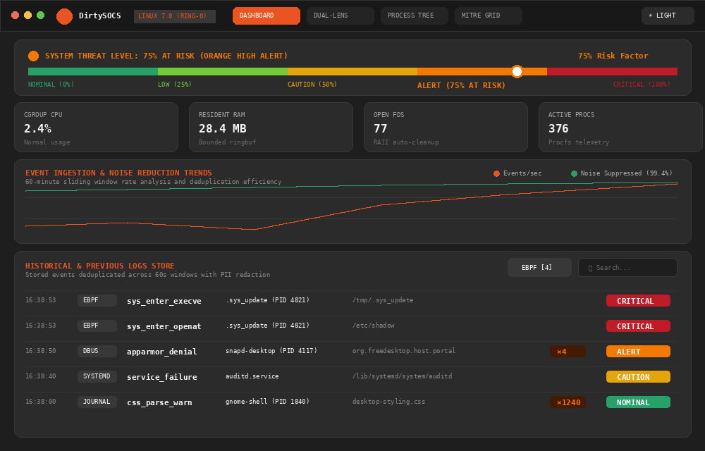
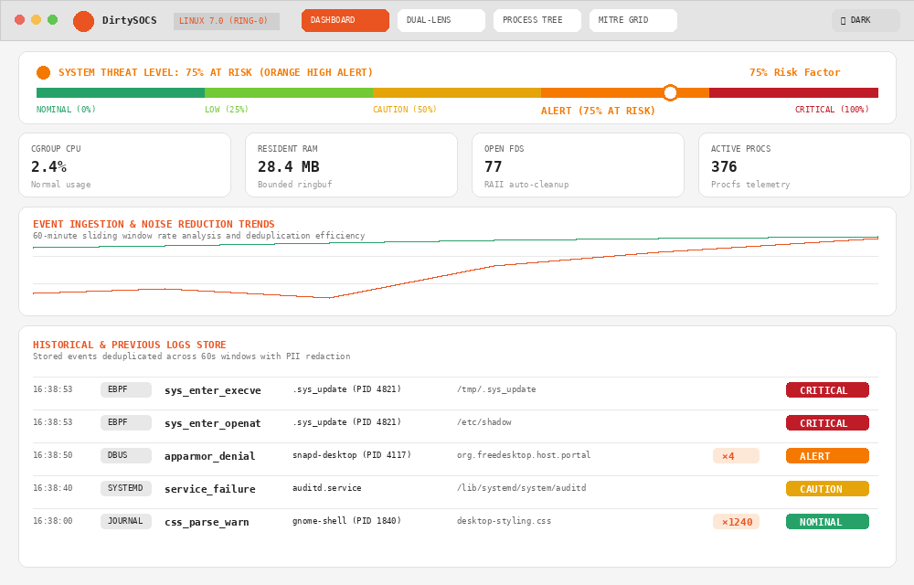
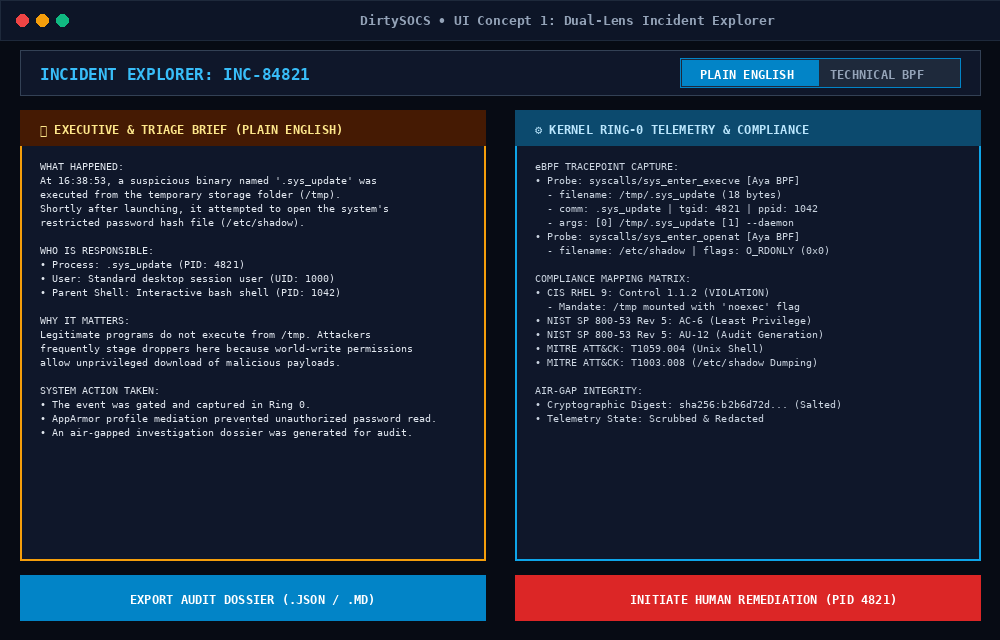
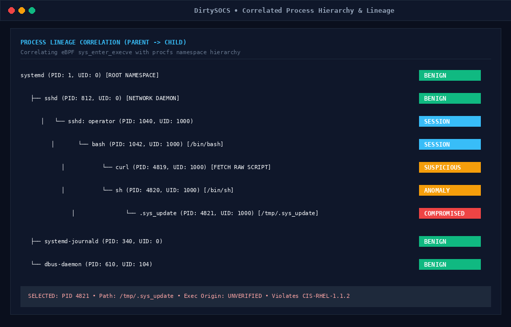
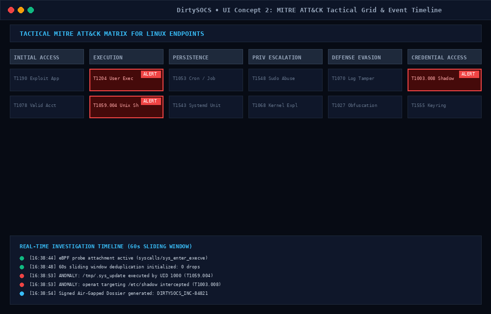
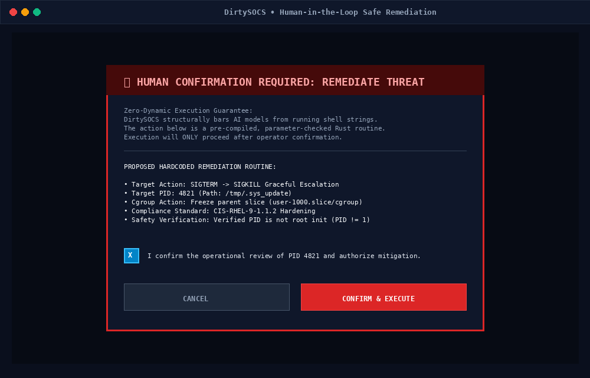

<div align="center">


# DirtySOCS
### Hybrid Kernel-Observability & Air-Gapped AI SOC Analyst System

[](https://opensource.org/licenses/MIT)
[-blue.svg)](https://docs.kernel.org/bpf/)
[-orange.svg)](https://aya-rs.dev/)
[](https://www.cisecurity.org/)
[](https://flutter.dev)

*A production-focused endpoint security daemon coupling read-only eBPF kernel telemetry with an air-gapped, privacy-preserving AI incident investigation pipeline and a native Flutter control plane.*

</div>

---

## Table of Contents
- [Executive Overview](#executive-overview)
- [Key Architectural Guarantees](#key-architectural-guarantees)
- [System Architecture](#system-architecture)
- [Embedded Security Knowledge Corpus](#embedded-security-knowledge-corpus)
- [Dual-Layer Visualization: Technical & Plain English](#dual-layer-visualization-technical--plain-english)
- [True Air-Gapped AI Dossier Pipeline](#true-air-gapped-ai-dossier-pipeline)
- [Human-in-the-Loop Remediation Engine](#human-in-the-loop-remediation-engine)
- [Screenshots & UI Showcase](#screenshots--ui-showcase)
- [Project Layout](#project-layout)
- [Quickstart & Verification](#quickstart--verification)
- [License](#license)

---

## Executive Overview

Modern security monitoring tools frequently suffer from two critical architectural flaws:
1. **Host Instability & High Overhead**: Fragile kernel modules or bloated user-space agents that consume excessive CPU cycles and introduce kernel panic risks.
2. **Data Privacy & AI Hallucination Vulnerabilities**: Rushing to connect internal production telemetry directly to public LLM endpoints, leaking sensitive credentials, internal IPs, and exposing systems to unvalidated command injection.

**DirtySOCS** resolves these trade-offs by enforcing strict boundaries across three operational tiers:
* **Ring 0 (Kernel Space)**: Pure Rust eBPF programs via [Aya](https://aya-rs.dev) attaching strictly read-only tracepoints (`sys_enter_execve`, `sys_enter_connect`, `sys_enter_openat`) verified safe by the Linux kernel in-kernel verifier.
* **Ring 3 (Userspace Daemon)**: An asynchronous Tokio daemon ingesting eBPF ring buffers, tailing `systemd-journald` in memory, and monitoring D-Bus via `zbus` for AppArmor mediation blocks and unit failures.
* **True Air-Gap AI Investigation**: Instead of silently phoning home, the daemon collapses noise using a 60-second sliding window, strips PII/credentials via deterministic regexes, pseudonymizes IPs using salted hashing, and generates an auditable **Forensic Dossier** for human review and export to the LLM of your choice.

---

## Key Architectural Guarantees

| Guarantee | Mechanism | Verification Method |
| :--- | :--- | :--- |
| **Zero Kernel Mutation** | Read-only eBPF tracepoints and non-blocking `RingBuf` | In-kernel BPF Verifier reject-on-write |
| **No Dangling Probes** | File-descriptor-bound BPF links unhooked upon process exit | Clean exit drops all kernel BPF references |
| **Privacy by Design** | Deterministic token redaction and salted BLAKE3/SHA-256 IP hashing | Pre-serialization regex gate & unit tests |
| **Zero AI Command Execution** | AI tier is strictly advisory; no shell or eval exists | Hardcoded, parameter-checked Rust RPC handlers |
| **Host Resource Guard** | Circular ring buffer dropping under backpressure | Verified bounded 1MB memory footprint |

---

## System Architecture

```
 ┌──────────────────────────────────────────────────────────────────┐
 │                      Linux Kernel (Ring 0)                       │
 │  aya eBPF: sys_enter_execve │ sys_enter_connect │ openat         │
 └─────────────────────────────────┬────────────────────────────────┘
                                   │ Read-Only RingBuf (1MB Non-Blocking)
                                   ▼
 ┌──────────────────────────────────────────────────────────────────┐
 │                  Rust Endpoint Daemon (Ring 3)                   │
 │  ├── D-Bus Listener (zbus): AppArmor Denials & Unit Crashes      │
 │  ├── Systemd Journal: In-memory sd-journal tailer                │
 │  ├── Deduplicator: 60s sliding window noise collapse             │
 │  ├── Redaction Pipeline: Regex PII stripper & Salted IP hasher   │
 │  ├── Compliance Engine: CIS RHEL 9 & NIST SP 800-53 Corpus       │
 │  └── Deterministic Baseline Gate: Trigger on anomalous anomalies │
 └────────────────┬─────────────────────────────────┬──────────────┘
                  │                                 │
     Length-Delimited Framed RPC                    │ Forensic Export (.json / .md)
      over Unix Domain Socket                       │ (No forced cloud phoning)
                  ▼                                 ▼
 ┌─────────────────────────────────┐   ┌────────────────────────────┐
 │      Flutter SOC Dashboard      │   │    Air-Gapped AI Model     │
 │  - Real-time /proc telemetry    │   │  - ChatGPT / Claude /      │
 │  - Process tree correlation     │   │    Local Ollama / vLLM     │
 │  - Technical & Plain English UI │   │  - Enforces Strict Schema  │
 │  - Human-in-the-Loop Actions    │   │  - Advisory only           │
 └─────────────────────────────────┘   └────────────────────────────┘
```

---

## Embedded Security Knowledge Corpus

DirtySOCS embeds a compliance engine directly within the daemon to cross-reference runtime anomalies against established security standards:

### 1. CIS Linux / Red Hat Enterprise Linux 9 Benchmark
* **Control 1.1 (Filesystem Integrity)**: Flags binaries executing out of unprivileged mounts (`/tmp`, `/dev/shm`, `/var/tmp`) without `noexec` options.
* **Control 1.6 (Mandatory Access Control)**: Monitors AppArmor and SELinux D-Bus mediation events and portal registrations.
* **Control 4.1 (System Accounting & Auditing)**: Enforces monitoring for process creation, network sockets, and privilege modifications.
* **Control 5.2 (Credential Protection)**: Tracks read/write attempts to `/etc/shadow`, `/etc/sudoers`, PAM modules, and `~/.ssh/authorized_keys`.

### 2. NIST SP 800-53 (Revision 5)
* **AU-2 / AU-12**: Event Logging and Automated Audit Record Generation.
* **AU-6**: Audit Record Review, Analysis, and Anomaly Reporting.
* **AC-6**: Least Privilege (tracking unexpected UID 0 elevations).
* **SI-4**: Information System Monitoring & Sensor Correlation.

### 3. CISSP Domain 7 (Security Operations)
* **Forensic Integrity & Chain of Custody**: Every exported incident dossier includes cryptographic hash digests of the 60-second telemetry window, preserving forensic evidentiary integrity.

---

## Dual-Layer Visualization: Technical & Plain English

A critical strength of DirtySOCS is translating low-level kernel telemetry into both actionable technical metrics and plain-English operational summaries:

```
┌────────────────────────────────────────────────────────────────────────┐
│ [CRITICAL] INC-91024 • MITRE ATT&CK: T1059.004 (Unix Shell Execution)  │
├────────────────────────────────────────────────────────────────────────┤
│ 📋 PLAIN ENGLISH EXPLANATION:                                          │
│ A hidden script (/tmp/.sys_update) was launched by an untrusted        │
│ process and attempted to read root shadow passwords. The system        │
│ blocked the attempt via AppArmor.                                      │
├────────────────────────────────────────────────────────────────────────┤
│ ⚙️ TECHNICAL TELEMETRY:                                                │
│ • Syscall: sys_enter_execve | PID: 4821 | PPID: 1042 (sh)              │
│ • Target File: /tmp/.sys_update -> /etc/shadow [sys_enter_openat]      │
│ • CIS Benchmark: CIS-RHEL-9-1.1.2 (Unauthorized execution from /tmp)   │
│ • NIST Control: NIST-SP800-53-AC-6 (Violation of Least Privilege)      │
│ • Cgroup CPU: 84.2% | RSS: 42.1 MB | Open FDs: 18                      │
├────────────────────────────────────────────────────────────────────────┤
│ 🛡️ RECOMMENDED MITIGATION:                                            │
│ Terminate PID 4821 and isolate parent cgroup.                          │
│ [ Review & Remediate (Human Confirmation Required) ]                   │
└────────────────────────────────────────────────────────────────────────┘
```

---

## True Air-Gapped AI Dossier Pipeline

DirtySOCS eliminates the risk of unauthorized cloud data leakage. Telemetry is scrubbed and exported on demand:

1. **Noise Deduplication**: 1,000+ repetitive log lines (e.g., desktop theme CSS parsing warnings or periodic D-Bus pings) are collapsed into compact count summaries:
   ```json
   {
     "event": "gnome-shell:css_parse_warning",
     "count": 1000,
     "window_sec": 60
   }
   ```
2. **Deterministic Redaction**:
   * Authorization tokens, API keys, private keys (`-----BEGIN ...`), and passwords are removed.
   * Host usernames and paths are masked (`/home/developer/.ssh` $\to$ `/home/<user>/.ssh`).
   * Internal IP addresses are consistently hashed with a local salt.
3. **One-Click Dossier Generation**: The operator can export a structured investigation bundle (`.json` or `.md`) containing the scrubbed telemetry, compliance tags, and an explicit system prompt for any LLM (Claude, ChatGPT, or an on-premise Ollama instance).
4. **Advisory Re-Ingestion**: Operators can paste the AI's structured response back into the dashboard to unlock ranked mitigation cards and one-click remediation.

---

## Human-in-the-Loop Remediation Engine

The AI model is strictly barred from executing dynamic commands on the host. When an advisory recommends action:
1. The operator clicks **"Review & Remediate"** in the Flutter UI.
2. A confirmation modal displays the hardcoded, deterministic action to be taken (e.g., `SIGTERM PID 4821`, `freeze_cgroup`, `restart_service`).
3. Upon explicit human confirmation, the UI sends a typed `RemediationRequest` over the Unix Domain Socket to the Rust daemon.
4. The daemon executes the pre-compiled Rust routine. **No shell strings or dynamic code from the AI are ever evaluated.**

---

## Screenshots & UI Showcase

<!-- Visual showcase of DirtySOCS Flutter desktop interface -->
| Ubuntu Native Dark Mode (75% Orange Risk) | Ubuntu Native Light Porcelain Mode |
| :---: | :---: |
|  |  |

| Dual-Lens View (Executive vs Technical) | Process Lineage Hierarchy Tree |
| :---: | :---: |
|  |  |

| Tactical MITRE ATT&CK Matrix Grid | Human-in-the-Loop Safe Remediation |
| :---: | :---: |
|  |  |

---

## Project Layout

```text
DirtySOCS/
├── Cargo.toml                      # Root virtual workspace
├── LICENSE                         # MIT License
├── README.md                       # Comprehensive system documentation
├── docs/
│   ├── assets/logo.svg             # Eye of Providence / Horus SOC vector icon
│   └── screenshots/                # Dashboard interface mockups
├── crates/
│   ├── soc-ebpf/                   # Kernel eBPF probes (sys_enter_execve, connect, openat)
│   ├── soc-common/                 # C-repr structs, telemetry schemas, compliance models
│   ├── soc-ipc/                    # Length-delimited framed JSON-RPC over Unix socket
│   └── soc-daemon/                 # Userspace Ring 3 daemon
│       ├── bpf_loader.rs           # Aya loader + ringbuf consumer + simulation fallback
│       ├── corpus/                 # Embedded CIS RHEL 9 & NIST SP 800-53 knowledge base
│       ├── dbus_monitor.rs         # zbus listener (AppArmor, portals, systemd)
│       ├── journal.rs              # systemd-journald memory tailer
│       ├── pipeline/               # 60s sliding window, regex PII scrubber, IP hasher
│       ├── heuristics.rs           # Deterministic baseline anomaly gate
│       ├── export.rs               # Air-gapped AI investigation dossier generator
│       ├── proc_metrics.rs         # Live /proc metrics (cgroup CPU, RSS, FDs)
│       ├── remediation.rs          # Hardcoded human-in-the-loop mitigation routines
│       └── ipc_server.rs           # Framed Unix Domain Socket server
└── apps/
    └── soc_dashboard/              # Flutter Linux desktop GUI
        ├── assets/logo.svg         # App icon
        └── lib/
            ├── main.dart
            ├── services/ipc.dart   # UDS client connecting to /tmp/dirtysocs.sock
            ├── models/             # Telemetry, advisories, metrics
            └── ui/                 # Cyberpunk SOC dashboard, tree, advisory cards
```

---

## Quickstart & Verification

### Prerequisites
* **Linux**: Kernel 5.8+ with BTF enabled (`/sys/kernel/btf/vmlinux`).
* **Rust**: 1.85+ (Stable for daemon, Nightly with `rust-src` for eBPF bytecode).
* **Flutter**: 3.20+ with Linux desktop prerequisites (`cmake`, `ninja-build`, `pkg-config`, `libgtk-3-dev`).

### 1. Build the eBPF Kernel Probes
```bash
cargo +nightly build --manifest-path crates/soc-ebpf/Cargo.toml --target bpfel-unknown-none -Z build-std=core --release
```

### 2. Build and Run the Userspace Daemon
```bash
# Run in live mode (requires root / CAP_BPF for kernel tracepoints)
sudo cargo run --bin soc-daemon -- --socket-path /tmp/dirtysocs.sock

# Or run in simulation mode for unprivileged evaluation and testing
cargo run --bin soc-daemon -- --socket-path /tmp/dirtysocs.sock --simulate-kernel-if-unprivileged
```

### 3. Launch the Flutter SOC Dashboard
```bash
cd apps/soc_dashboard
flutter run -d linux
```

---

## License

This project is licensed under the **MIT License** - see the [LICENSE](LICENSE) file for details.
Open source, community-friendly, and designed for transparent security engineering.
